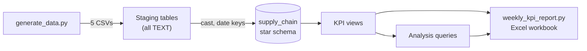
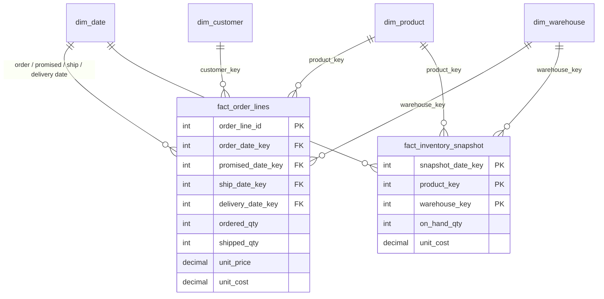

# Supply Chain KPI Warehouse (MySQL, Python)

MySQL warehouse for supply chain reporting. 40,000 order lines and 23,400 weekly inventory snapshots are modeled as a star schema, the four core KPIs (OTIF, fill rate, backlog, inventory turns) are defined once in SQL views, and a Python script turns them into a weekly Excel report.

The data is simulated: an industrial distributor shipping 60 SKUs from 5 distribution centers to 150 customers, January 2025 to June 2026. The generator is seeded, so every run produces the same data.

## Architecture



## Data model

Two fact tables sharing four dimensions.



| Table | Grain | Rows |
|---|---|---:|
| `fact_order_lines` | order line | 40,000 |
| `fact_inventory_snapshot` | product, warehouse, week | 23,400 |
| `dim_date` | calendar day | 761 |
| `dim_product` | SKU | 60 |
| `dim_customer` | customer | 150 |
| `dim_warehouse` | distribution center | 5 |

`fact_order_lines` joins to `dim_date` four times (order, promised, ship and delivery date). Inventory is a balance rather than a transaction, so it has its own snapshot fact table. `dim_date` is generated with a recursive CTE.

## KPI definitions

Defined in `02_kpi_views/01_create_kpi_views.sql`.

| KPI | View | Definition |
|---|---|---|
| OTIF | `vw_otif_weekly` | Due lines delivered by the promised date and shipped in full, divided by all due lines |
| Fill rate | `vw_fill_rate_weekly` | Units shipped / units ordered (unit fill rate), and lines shipped complete / lines ordered (line fill rate) |
| Backlog | `vw_backlog_weekly` | Lines ordered but not shipped at each week end, in lines, units and dollars, with the past due portion |
| Inventory turns | `vw_inventory_turns_monthly` | Monthly COGS x 12 / average inventory value from that month's snapshots, plus days of supply |

The views keep counts and sums alongside each ratio so totals can be rolled up correctly, for example `SUM(lines_otif) / SUM(lines_due)`. Weekly views include complete weeks only.

## Results

Network totals, January 2025 to June 2026:

| KPI | Value |
|---|---:|
| OTIF | 77.1% |
| On time | 83.6% |
| In full | 91.9% |
| Unit fill rate | 96.5% |
| Inventory turns (May 2026, annualized) | 9.1 |

These match an independent pandas calculation on the raw CSVs.

### OTIF trend
[`01_otif_trend.sql`](03_analysis/01_otif_trend.sql): weekly OTIF, a 4-week rolling rate and the week-over-week change (`LAG`).

| Week start | Lines due | OTIF | 4 wk rolling | WoW change |
|---|---:|---:|---:|---:|
| 2026-06-22 | 620 | 70.8% | 74.7% | -5.6 pts |
| 2026-06-15 | 641 | 76.4% | 75.7% | +3.2 pts |
| 2026-06-08 | 595 | 73.3% | 75.1% | -5.1 pts |
| 2026-06-01 | 579 | 78.4% | 74.9% | +3.8 pts |
| 2026-05-25 | 607 | 74.6% | 74.8% | +0.4 pts |

The rolling rate has been around 75% since late May, below the 77.1% average for the full period, as supplier backorders built up from April.

### Warehouse scorecard
[`02_warehouse_scorecard.sql`](03_analysis/02_warehouse_scorecard.sql): last 13 weeks against the previous 13, ranked with `RANK()`.

| Rank | Warehouse | OTIF last 13 wk | OTIF prior 13 wk | Change | Unit fill rate | Turns |
|---:|---|---:|---:|---:|---:|---:|
| 1 | DC Atlanta | 80.1% | 82.5% | -2.5 pts | 94.6% | 9.1 |
| 2 | DC Dallas | 78.7% | 83.2% | -4.5 pts | 94.5% | 9.9 |
| 3 | DC Chicago | 78.7% | 80.4% | -1.7 pts | 95.0% | 9.1 |
| 4 | DC Newark | 70.9% | 74.1% | -3.2 pts | 93.6% | 8.2 |
| 5 | DC Los Angeles | 68.4% | 71.9% | -3.5 pts | 95.5% | 9.3 |

Newark and Los Angeles are 8 to 12 points behind the other three on OTIF. Los Angeles has the highest fill rate, so its problem is late shipments rather than missing stock.

### Shortfall by SKU
[`03_problem_skus.sql`](03_analysis/03_problem_skus.sql): units short per SKU over the last 13 weeks, with share of total and cumulative share (`SUM() OVER`), and rank within category (`DENSE_RANK`).

| SKU | Product | Category | Units short | Fill rate | Share | Cumulative |
|---|---|---|---:|---:|---:|---:|
| POW-0020 | Power Module | Power Supplies | 484 | 94.2% | 10.4% | 10.4% |
| POW-0024 | Buffer Module | Power Supplies | 407 | 93.2% | 8.7% | 19.1% |
| POW-0016 | Battery Pack | Power Supplies | 374 | 93.4% | 8.0% | 27.1% |
| POW-0022 | Voltage Regulator | Power Supplies | 345 | 92.3% | 7.4% | 34.5% |
| SEN-0026 | Temperature Sensor | Sensors | 284 | 94.8% | 6.1% | 40.6% |

5 of the 60 SKUs account for 40.6% of units short, and 4 of those are power supplies.

### Backlog aging
[`04_backlog_aging.sql`](03_analysis/04_backlog_aging.sql): open lines at the end of the data, by days since order.

| Age | Open lines | Open value | Share of value | Past due lines |
|---|---:|---:|---:|---:|
| 0 to 7 days | 159 | $147,968 | 50.8% | 5 |
| 8 to 14 days | 30 | $26,172 | 9.0% | 25 |
| 15 to 30 days | 33 | $19,926 | 6.8% | 33 |
| Over 30 days | 120 | $96,984 | 33.3% | 120 |

About half the open value is orders from the last week. A third is more than 30 days old, and all of those lines are past due.

## Weekly report

`04_reporting/weekly_kpi_report.py` queries the KPI views, runs the scripts in `03_analysis/` directly, and saves a formatted workbook to `reports/`:

| Tab | Contents |
|---|---|
| Summary | Each KPI for the latest week, the prior week and the 13-week average, with the change colored |
| OTIF Trend | 13 weeks of OTIF, on time, in full and fill rate, with a line chart |
| Warehouse Scorecard | Output of `02_warehouse_scorecard.sql` |
| Problem SKUs | Output of `03_problem_skus.sql` |
| Backlog Aging | Output of `04_backlog_aging.sql` |
| Inventory Turns | Turns by warehouse for the last 6 months |

```
Report week: 2026-06-22
Saved: reports/weekly_kpi_report_2026-06-22.xlsx
Tabs: Summary, OTIF Trend, Warehouse Scorecard, Problem SKUs, Backlog Aging, Inventory Turns
Generated in 1.4 seconds
```

To run it every Monday with cron:
`0 7 * * 1 cd /path/to/repo && .venv/bin/python 04_reporting/weekly_kpi_report.py`

## How to run

Requires MySQL 8 or later and Python 3.9 or later.

```bash
git clone https://github.com/Patel-Swayam7/supply-chain-kpi-warehouse.git
cd supply-chain-kpi-warehouse
python3 -m venv .venv
source .venv/bin/activate
pip install -r requirements.txt

# Generate data, build the warehouse and create the views
mysql -u root -e "SET GLOBAL local_infile = 1;"
bash build_all.sh

# Analysis
mysql -u root -t < 03_analysis/01_otif_trend.sql
mysql -u root -t < 03_analysis/02_warehouse_scorecard.sql
mysql -u root -t < 03_analysis/03_problem_skus.sql
mysql -u root -t < 03_analysis/04_backlog_aging.sql

# Weekly report
python3 04_reporting/weekly_kpi_report.py
```

The report script reads connection settings from `~/.my.cnf`, or from `MYSQL_HOST`, `MYSQL_PORT`, `MYSQL_USER` and `MYSQL_PASSWORD`.

## Files

```
supply-chain-kpi-warehouse/
├── requirements.txt
├── build_all.sh
├── 00_generate_data/
│   └── generate_data.py
├── 01_warehouse/
│   ├── 01_create_tables.sql
│   └── 02_load_data.sql
├── 02_kpi_views/
│   └── 01_create_kpi_views.sql
├── 03_analysis/
│   ├── 01_otif_trend.sql
│   ├── 02_warehouse_scorecard.sql
│   ├── 03_problem_skus.sql
│   └── 04_backlog_aging.sql
└── 04_reporting/
    └── weekly_kpi_report.py
```

All company, customer and product names are fictional.
