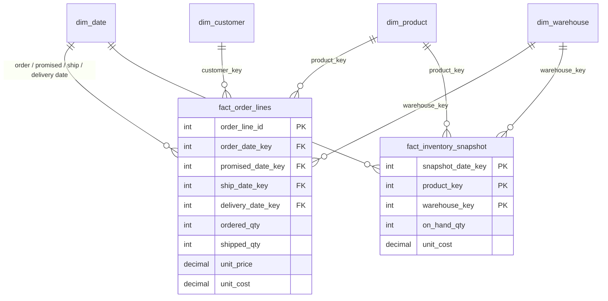

# Supply Chain KPI Warehouse (MySQL + Python)

A supply chain analytics warehouse that turns 40,000 order lines and 23,400 inventory snapshots into the four KPIs operations teams run on: **OTIF, fill rate, backlog and inventory turns**. The KPIs are defined once in reusable SQL views and delivered as an **automated weekly Excel report** generated in about 2 seconds.

The business: a simulated industrial distributor shipping 60 SKUs (electrical components, power supplies, sensors, cables, control panels) from **5 distribution centers** to **150 customers**, January 2025 to June 2026.

---

## Table of Contents
- [Architecture](#architecture)
- [Data Model](#data-model)
- [KPI Definitions](#kpi-definitions)
- [Results](#results)
- [Automated Weekly Report](#automated-weekly-report)
- [Engineering Decisions](#engineering-decisions)
- [How to Run](#how-to-run)
- [Project Structure](#project-structure)
- [What I Learned](#what-i-learned)

---

## Architecture


---

## Data Model

A star schema with **2 fact tables** and **4 shared dimensions**.



| Table | Grain | Rows |
|---|---|---:|
| `fact_order_lines` | one order line | 40,000 |
| `fact_inventory_snapshot` | product × warehouse × week | 23,400 |
| `dim_date` | one calendar day (built with a recursive CTE) | 761 |
| `dim_product` | one SKU | 60 |
| `dim_customer` | one customer | 150 |
| `dim_warehouse` | one distribution center | 5 |

`fact_order_lines` is a role-playing fact: it joins to `dim_date` four times (order, promised, ship, delivery date).

---

## KPI Definitions

All KPIs live in `02_kpi_views/01_create_kpi_views.sql`, so the analysis queries, the Excel report and any future dashboard use the same definition.

| KPI | View | Definition |
|---|---|---|
| **OTIF** | `vw_otif_weekly` | Due order lines delivered on or before the promised date **and** shipped in full ÷ all due lines |
| **Fill rate** | `vw_fill_rate_weekly` | Unit fill rate = units shipped ÷ units ordered. Line fill rate = lines shipped complete ÷ lines ordered |
| **Backlog** | `vw_backlog_weekly` | Order lines received but not shipped at each week end (Sunday), in lines, units and $ value, with a past-due split |
| **Inventory turns** | `vw_inventory_turns_monthly` | (Monthly COGS × 12) ÷ average inventory value from that month's weekly snapshots, plus days of supply |

Each view stores **additive counts and sums** next to the ratio, so totals roll up correctly (`SUM(lines_otif) / SUM(lines_due)`), never as an average of weekly percentages.

---

## Results

### Network KPIs (Jan 2025 to Jun 2026, complete weeks)
| KPI | Value |
|---|---:|
| OTIF | 77.1% |
| On time | 83.6% |
| In full | 91.9% |
| Unit fill rate | 96.5% |
| Inventory turns (annualized, May 2026) | 9.1 |

### 1. OTIF trend ([`01_otif_trend.sql`](03_analysis/01_otif_trend.sql))
Weekly OTIF with a 4-week rolling rate (window over rolling sums) and week-over-week change with `LAG()`.

| Week start | Lines due | OTIF | 4 wk rolling | WoW change |
|---|---:|---:|---:|---:|
| 2026-06-22 | 620 | 70.8% | 74.7% | −5.6 pts |
| 2026-06-15 | 641 | 76.4% | 75.7% | +3.2 pts |
| 2026-06-08 | 595 | 73.3% | 75.1% | −5.1 pts |
| 2026-06-01 | 579 | 78.4% | 74.9% | +3.8 pts |
| 2026-05-25 | 607 | 74.6% | 74.8% | +0.4 pts |

**Takeaway:** the rolling rate has settled around 75%, below the 77.1% full-period average, driven by a build-up of supplier backorders since April.

### 2. Warehouse scorecard ([`02_warehouse_scorecard.sql`](03_analysis/02_warehouse_scorecard.sql))
Last 13 weeks vs the 13 weeks before, ranked with `RANK()`.

| OTIF rank | Warehouse | OTIF (last 13 wk) | OTIF (prior 13 wk) | Change | Unit fill rate | Turns |
|---:|---|---:|---:|---:|---:|---:|
| 1 | DC Atlanta | 80.1% | 82.5% | −2.5 pts | 94.6% | 9.1 |
| 2 | DC Dallas | 78.7% | 83.2% | −4.5 pts | 94.5% | 9.9 |
| 3 | DC Chicago | 78.7% | 80.4% | −1.7 pts | 95.0% | 9.1 |
| 4 | DC Newark | 70.9% | 74.1% | −3.2 pts | 93.6% | 8.2 |
| 5 | DC Los Angeles | 68.4% | 71.9% | −3.5 pts | 95.5% | 9.3 |

**Takeaway:** Los Angeles and Newark trail the top three DCs by 8 to 12 points of OTIF. LA's fill rate is the best in the network, so its gap is **lateness, not stock**: the fix is in warehouse processing, not inventory.

### 3. Problem SKUs ([`03_problem_skus.sql`](03_analysis/03_problem_skus.sql))
Shortfall per SKU with `SUM() OVER ()` share, running cumulative share, and `DENSE_RANK()` within category.

| SKU | Product | Category | Units short | Fill rate | Share of shortfall | Cumulative |
|---|---|---|---:|---:|---:|---:|
| POW-0020 | Power Module | Power Supplies | 484 | 94.2% | 10.4% | 10.4% |
| POW-0024 | Buffer Module | Power Supplies | 407 | 93.2% | 8.7% | 19.1% |
| POW-0016 | Battery Pack | Power Supplies | 374 | 93.4% | 8.0% | 27.1% |
| POW-0022 | Voltage Regulator | Power Supplies | 345 | 92.3% | 7.4% | 34.5% |
| SEN-0026 | Temperature Sensor | Sensors | 284 | 94.8% | 6.1% | 40.6% |

**Takeaway:** 5 of 60 SKUs cause 40.6% of all units shorted, and 4 of them are power supplies. Safety stock and supplier follow-up on that one category gives the biggest fill rate win.

### 4. Backlog aging ([`04_backlog_aging.sql`](03_analysis/04_backlog_aging.sql))

| Age since order | Open lines | Open value | Share of value | Past due lines |
|---|---:|---:|---:|---:|
| 0 to 7 days | 159 | $147,968 | 50.8% | 5 |
| 8 to 14 days | 30 | $26,172 | 9.0% | 25 |
| 15 to 30 days | 33 | $19,926 | 6.8% | 33 |
| 30+ days | 120 | $96,984 | 33.3% | 120 |

**Takeaway:** half the backlog is normal new orders, but a third of its value has been open for more than 30 days and is entirely past due. Those 120 lines are the escalation list.

---

## Automated Weekly Report

`04_reporting/weekly_kpi_report.py` connects to MySQL, runs the KPI views and the **same `.sql` files** in `03_analysis/` (so the report and the SQL never drift apart), and writes a formatted workbook to `reports/`:

| Tab | Contents |
|---|---|
| Summary | Each KPI this week vs last week vs 13-week average, with improvements in green and declines in red |
| OTIF Trend | 13 weeks of OTIF, on time, in full and fill rate, plus a line chart |
| Warehouse Scorecard | DC ranking (query 2) |
| Problem SKUs | Top shortfall SKUs (query 3) |
| Backlog Aging | Open orders by age (query 4) |
| Inventory Turns | Last 6 months of turns by DC |

```
Report week: 2026-06-22
Saved: reports/weekly_kpi_report_2026-06-22.xlsx
Tabs: Summary, OTIF Trend, Warehouse Scorecard, Problem SKUs, Backlog Aging, Inventory Turns
Generated in 2.2 seconds
```

It can be scheduled to run every Monday with cron, for example: `0 7 * * 1 cd /path/to/repo && .venv/bin/python 04_reporting/weekly_kpi_report.py`

---

## Engineering Decisions

| Decision | Why |
|---|---|
| **Seeded data generator with built-in realism** | Each DC has its own speed and reliability, some categories stock out more, and recent supplier backorders pile up. The KPIs have real patterns to find, and anyone who runs the generator gets identical data. |
| **ELT with all-text staging tables** | CSVs land as text, then cast into typed tables, with staged vs loaded row reconciliation and 5 business-rule checks (for example, shipped never exceeds ordered). |
| **Integer date keys + a generated `dim_date`** | The standard warehouse pattern: fast joins and easy grouping by week, month or quarter. Built with a recursive CTE, so no calendar file is needed. |
| **Separate inventory snapshot fact** | Inventory is a point-in-time balance, not a transaction, so it gets its own fact table at weekly grain. That's what makes inventory turns possible. |
| **Complete weeks only** | The last partial week is excluded from weekly rates so a 2-day week can't look like a collapse. |
| **KPI logic in views, report in Python** | SQL owns the definitions, and Python only formats. Changing a KPI means editing one view. |

**Validation:** network OTIF (77.1%) and unit fill rate (96.5%) were cross-checked against an independent pandas calculation on the raw CSVs, and matched.

---

## How to Run

**Requirements:** MySQL 8+, Python 3.9+

```bash
# 1. Clone and set up Python
git clone <this-repo-url>
cd supply-chain-kpi-warehouse
python3 -m venv .venv
source .venv/bin/activate
pip install -r requirements.txt

# 2. Generate the data (5 CSVs into data/)
python3 00_generate_data/generate_data.py

# 3. Build the warehouse and KPI views
mysql -u root -e "SET GLOBAL local_infile = 1;"
mysql --local-infile=1 -u root < build_all.sql

# 4. Run the analysis
mysql -u root -t < 03_analysis/01_otif_trend.sql
mysql -u root -t < 03_analysis/02_warehouse_scorecard.sql
mysql -u root -t < 03_analysis/03_problem_skus.sql
mysql -u root -t < 03_analysis/04_backlog_aging.sql

# 5. Generate the weekly Excel report
python3 04_reporting/weekly_kpi_report.py
```

The report script reads connection settings from `~/.my.cnf` if present, or from the environment variables `MYSQL_HOST`, `MYSQL_PORT`, `MYSQL_USER` and `MYSQL_PASSWORD`.

---

## Project Structure

```
supply-chain-kpi-warehouse/
├── README.md
├── requirements.txt
├── build_all.sql                         # warehouse + views in one command
├── 00_generate_data/
│   └── generate_data.py                  # seeded, realistic simulated data
├── 01_warehouse/
│   ├── 01_create_tables.sql              # star schema + dim_date via recursive CTE
│   └── 02_load_data.sql                  # CSV -> staging -> warehouse + DQ checks
├── 02_kpi_views/
│   └── 01_create_kpi_views.sql           # OTIF, fill rate, backlog, inventory turns
├── 03_analysis/
│   ├── 01_otif_trend.sql
│   ├── 02_warehouse_scorecard.sql
│   ├── 03_problem_skus.sql
│   └── 04_backlog_aging.sql
├── 04_reporting/
│   └── weekly_kpi_report.py              # automated Excel report
├── data/                                 # generated CSVs (git-ignored)
└── reports/                              # generated reports (git-ignored)
```

---

## What I Learned

- **Supply chain KPIs as precise definitions:** what counts as "due", why OTIF and fill rate tell different stories, and why backlog needs aging.
- **Dimensional modeling:** transaction facts vs snapshot facts, role-playing date dimensions, and choosing the grain.
- **SQL for analytics:** views, CTEs, recursive CTEs, window functions (`LAG`, `RANK`, `DENSE_RANK`, rolling and cumulative `SUM() OVER`), and conditional aggregation.
- **Reporting automation:** Python + pandas + openpyxl to turn SQL output into a stakeholder-ready workbook in seconds.

---

*Data is simulated for portfolio purposes. Company, customer and product names are fictional.*
