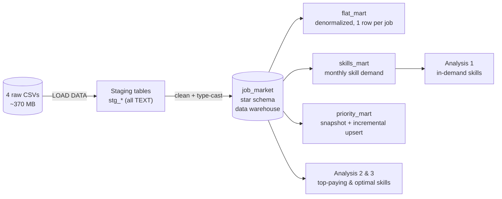
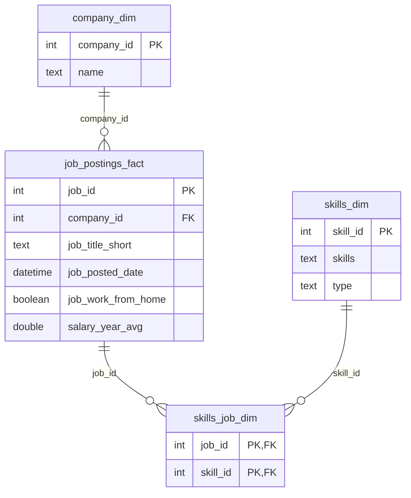

# Job Market Data Warehouse & Analytics (MySQL)

An end-to-end SQL data engineering project: **4 raw CSV files (1.6M job postings) → staging → star schema data warehouse → 3 data marts → analysis** of the most in-demand, highest-paying, and most "optimal" skills for data engineers.

Built in **MySQL** by following and adapting the DuckDB-based projects from [Luke Barousse's *SQL for Data Engineering* course](https://github.com/lukebarousse/SQL_Data_Engineering_Course) (Project 1: EDA, Project 2: Warehouse & Mart Build), combined here into a single pipeline. All SQL was translated from DuckDB to MySQL, which required redesigning several pieces (see [MySQL Engineering Notes](#mysql-engineering-notes)).

---

## Table of Contents
- [Architecture](#architecture)
- [Dataset](#dataset)
- [Pipeline Steps](#pipeline-steps)
- [Analysis & Findings](#analysis--findings)
- [MySQL Engineering Notes](#mysql-engineering-notes)
- [How to Run](#how-to-run)
- [Project Structure](#project-structure)
- [What I Learned](#what-i-learned)

---

## Architecture



### Star schema (warehouse)



---

## Dataset

Real-world data job postings collected by Luke Barousse and provided with the course as 4 CSV files:

| Table | Type | Rows loaded |
|---|---|---:|
| `job_postings_fact` | Fact | 1,615,930 |
| `company_dim` | Dimension | 215,940 |
| `skills_dim` | Dimension | 262 |
| `skills_job_dim` | Bridge (many-to-many) | 7,193,426 |

---

## Pipeline Steps

| Step | Script | What it does |
|---|---|---|
| 1 | `01_warehouse/01_create_tables.sql` | Creates the `job_market` database and the star schema (fact, 2 dimensions, bridge) with primary and foreign keys. Idempotent: safe to re-run. |
| 2 | `01_warehouse/02_load_data.sql` | Loads each CSV into an all-text **staging** table, then cleans and type-casts into the warehouse (dimensions → fact → bridge, in foreign-key order). Ends with row-count reconciliation and referential-integrity checks. |
| 3 | `02_marts/03_create_flat_mart.sql` | **Flat mart:** one wide row per job posting (1,615,930 rows) with company name and all skills packed into a JSON array, so analysts need no joins. |
| 4 | `02_marts/04_create_skills_mart.sql` | **Skills mart:** a dimensional mart (`dim_skill`, `dim_date_month`, `fact_skill_demand_monthly`) rolling 7.2M skill-job links up to 52,520 monthly rows of additive counts. |
| 5 | `02_marts/05_create_priority_mart.sql` | **Priority mart:** a snapshot of jobs for priority roles, each stamped with a priority level and `updated_at`. |
| 6 | `02_marts/06_update_priority_mart.sql` | **Incremental update (upsert):** applies a business-rule change by updating only changed jobs, inserting new ones and deleting removed ones, in a single transaction (906,525 jobs after the update). |
| ▶ | `build_all.sh` | Runs steps 1–6 in order with one command. |

### Data quality checks built into the load
- **Reconciliation:** staging row count vs. warehouse row count per table
- **Referential integrity:** orphaned `company_id`, `skill_id` and `job_id` checks (all 0)
- **Safe typing:** blanks → `NULL`, `True`/`False` → boolean, Windows line endings stripped

---

## Analysis & Findings

All three questions focus on **remote Data Engineer** roles. My MySQL results match the course's DuckDB results (query 1 and 2 exactly; query 3 within ±0.01 from rounding), which validates the translated pipeline end to end.

### 1. What are the most in-demand skills for data engineers?
[`03_analysis/01_top_demanded_skills.sql`](03_analysis/01_top_demanded_skills.sql): built on the **skills mart**, so it needs no joins against the 7M-row bridge table.

| Skill | Remote DE postings |
|---|---:|
| sql | 29,221 |
| python | 28,776 |
| aws | 17,823 |
| azure | 14,143 |
| spark | 12,799 |
| airflow | 9,996 |
| snowflake | 8,639 |
| databricks | 8,183 |
| java | 7,267 |
| gcp | 6,446 |

**Takeaways**
- **SQL and Python** are the foundation: each appears in ~29K postings, roughly 1.6× the next skill.
- **Cloud** comes next: AWS (~17.8K) and Azure (~14.1K), with GCP in the top 10.
- **Big data and pipeline tools** (Spark, Airflow, Snowflake, Databricks) round out the list.

### 2. What are the highest-paying skills for data engineers?
[`03_analysis/02_top_paying_skills.sql`](03_analysis/02_top_paying_skills.sql): median salary for skills with at least 100 remote DE postings (top 10 of 25 shown).

| Skill | Median salary | Postings |
|---|---:|---:|
| rust | $210,000 | 232 |
| golang | $184,000 | 912 |
| terraform | $184,000 | 3,248 |
| spring | $175,500 | 364 |
| neo4j | $170,000 | 277 |
| gdpr | $169,616 | 582 |
| zoom | $168,438 | 127 |
| graphql | $167,500 | 445 |
| mongo | $162,250 | 265 |
| fastapi | $157,500 | 204 |

**Takeaways**
- **Rust** tops the list at $210K but is relatively niche (232 postings).
- **Terraform** combines a top salary ($184K) with real demand (3,248 postings).
- Core pipeline tools still pay well at high volume: **Kubernetes** $150.5K (4,202 postings), **Airflow** $150K (9,996 postings).

### 3. What are the most optimal skills (high demand and high pay)?
[`03_analysis/03_optimal_skills.sql`](03_analysis/03_optimal_skills.sql): `optimal_score = LN(demand) × median salary / 1,000,000`, using remote DE postings with a listed salary (top 10 of 25 shown).

| Skill | Median salary | Demand | Optimal score |
|---|---:|---:|---:|
| terraform | $184,000 | 193 | 0.97 |
| python | $135,000 | 1,133 | 0.95 |
| aws | $137,320 | 783 | 0.91 |
| sql | $130,000 | 1,128 | 0.91 |
| airflow | $150,000 | 386 | 0.89 |
| spark | $140,000 | 503 | 0.87 |
| kafka | $145,000 | 292 | 0.82 |
| snowflake | $135,500 | 438 | 0.82 |
| azure | $128,000 | 475 | 0.79 |
| java | $135,000 | 303 | 0.77 |

**Takeaways**
- **Python, SQL and AWS** are the safest bets: highest demand with solid salaries.
- **Terraform and Airflow** score highly thanks to premium pay, signaling the value of infrastructure and orchestration skills.
- The natural log keeps very common skills from drowning out salary, so the ranking rewards skills that are *both* well paid and widely requested.

---

## MySQL Engineering Notes

The course uses DuckDB. Translating to MySQL required these design changes:

| Challenge | DuckDB (course) | My MySQL solution |
|---|---|---|
| Loading CSVs | `read_csv()` with auto-detect | `LOAD DATA LOCAL INFILE` into **all-text staging tables**, then a cleaning `INSERT … SELECT`. Bad values get handled in SQL instead of crashing the load, and row counts can be reconciled. |
| Real-world data lengths | `VARCHAR` (unbounded) | The first load failed on row 136,576 (a company name longer than 512 characters), so I switched text fields to `TEXT`. |
| CSV column order | Matched by header name | Verified each file's header (`skills_job_dim.csv` is `job_id, skill_id`, not the table's column order) and mapped columns explicitly. |
| Schemas | `CREATE SCHEMA flat_mart` | Each mart is its own MySQL database reading from `job_market` (MySQL treats schemas and databases as the same thing). |
| Nested data | `ARRAY_AGG(STRUCT_PACK(...))` | `JSON_ARRAYAGG(JSON_OBJECT(...))` into a `JSON` column, with an empty array for jobs without skills. |
| Upserts | `MERGE INTO … WHEN MATCHED / NOT MATCHED / NOT MATCHED BY SOURCE` | `INSERT … ON DUPLICATE KEY UPDATE` (refreshes `updated_at` only when the priority actually changes) plus `DELETE … LEFT JOIN`, wrapped in a **transaction**. |
| Median | `MEDIAN()` | No built-in, so I calculated it with **window functions**: `ROW_NUMBER()` and `COUNT() OVER (PARTITION BY skill)`, keeping the middle row(s). |
| Dates | `DATE_TRUNC('month', d)` | `CAST(DATE_FORMAT(d, '%Y-%m-01') AS DATE)`, `QUARTER()`, `CONCAT()` |

---

## How to Run

**Requirements:** MySQL 8+ and a terminal (macOS/Linux).

```bash
# 1. Clone the repo
git clone <this-repo-url>
cd job-market-data-warehouse

# 2. Download the raw data (not stored in the repo, ~370 MB)
mkdir -p data
for f in company_dim skills_dim job_postings_fact skills_job_dim; do
  curl -o data/$f.csv https://storage.googleapis.com/sql_de/$f.csv
done

# 3. Allow local file loading, then build everything (about 10–20 minutes)
mysql -u root -e "SET GLOBAL local_infile = 1;"
bash build_all.sh

# 4. Run the analysis
mysql -u root -t < 03_analysis/01_top_demanded_skills.sql
mysql -u root -t < 03_analysis/02_top_paying_skills.sql
mysql -u root -t < 03_analysis/03_optimal_skills.sql
```

---

## Project Structure

```
job-market-data-warehouse/
├── README.md
├── build_all.sh                      # runs the full pipeline
├── 01_warehouse/
│   ├── 01_create_tables.sql          # star schema DDL
│   └── 02_load_data.sql              # CSV -> staging -> warehouse + DQ checks
├── 02_marts/
│   ├── 03_create_flat_mart.sql
│   ├── 04_create_skills_mart.sql
│   ├── 05_create_priority_mart.sql
│   └── 06_update_priority_mart.sql   # incremental upsert
├── 03_analysis/
│   ├── 01_top_demanded_skills.sql
│   ├── 02_top_paying_skills.sql
│   └── 03_optimal_skills.sql
└── data/                             # raw CSVs (git-ignored)
```

---

## What I Learned

- **Dimensional modeling:** designing fact, dimension and bridge tables, and choosing a mart's *grain* so its measures stay additive.
- **ELT with a staging layer:** landing raw data first, then cleaning and typing in SQL, with reconciliation and referential-integrity checks.
- **Incremental loads:** upserting changes instead of full rebuilds, kept consistent with transactions.
- **Advanced SQL:** CTEs, window functions (a hand-built median), JSON aggregation, `CASE`, set operations.
- **Debugging real data:** handling oversized values, column-order mismatches, and engine differences between DuckDB and MySQL.

---

## Credits

Dataset and original project design: [Luke Barousse — SQL for Data Engineering](https://github.com/lukebarousse/SQL_Data_Engineering_Course). MySQL translation, staging-layer design, the upsert/median rewrites and the combined pipeline are my own adaptation.
